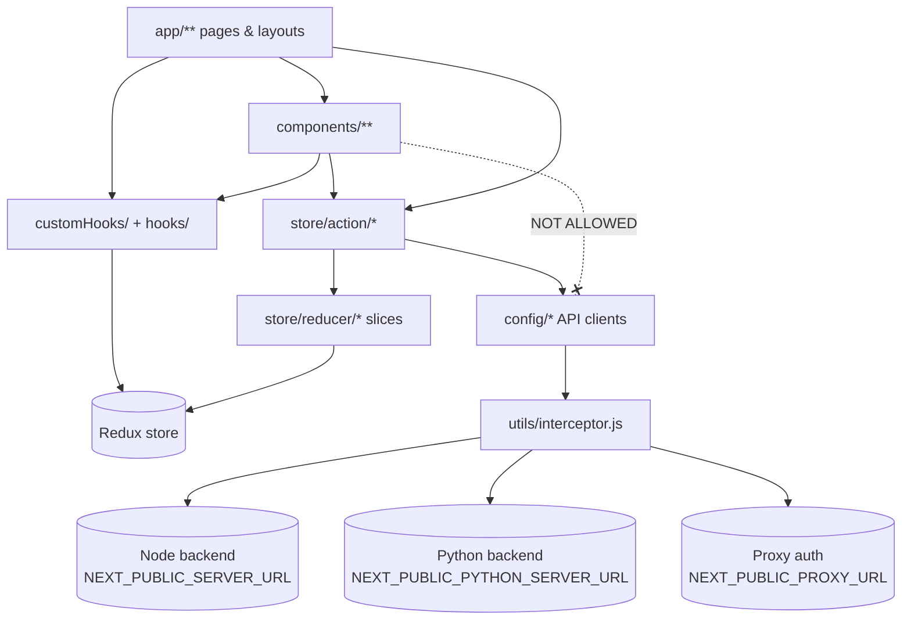
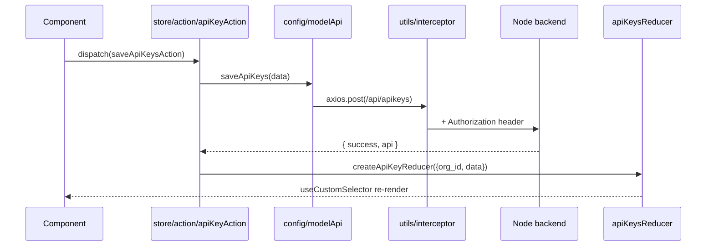

# Architecture — GTWY AI Frontend

> AI-oriented architecture reference and source of truth for agents. Last verified: 2026-10-13 at commit `ba0d89ee`.
> Companion docs: [../ARCHITECTURE.md](../ARCHITECTURE.md) (narrative overview) and [../AI_INSTRUCTIONS.md](../AI_INSTRUCTIONS.md) (design constitution, component rules, **embed architecture**).

## What this product is

GTWY AI is a multi-tenant platform for building, configuring and monitoring LLM agents across many providers (OpenAI, Anthropic, Gemini, Groq, …). This repo is **only the web frontend**: a client-heavy Next.js app that talks to two backends (Node `SERVER_URL`, Python `PYTHON_SERVER_URL`) and a proxy auth service (`PROXY_URL`). It also ships an **embed surface**: GTWY can run inside an iframe on customer sites (`app/embed/`, `public/gtwy.js`).

Core user flow: log in → choose an org (`/org`) → create or open an agent (`/org/[org_id]/agents`) → configure prompt, model, tools and knowledge base (`agents/configure/[id]`) → test in the side chat → publish a version → watch history and metrics.

## Tech stack

| Layer      | Technology                                                                         | Version         | Notes                                                                    |
| ---------- | ---------------------------------------------------------------------------------- | --------------- | ------------------------------------------------------------------------ |
| Language   | JavaScript (JSX); a few `.tsx` files                                               | —               | No `tsconfig.json`; `jsconfig.json` only sets the `@/*` alias            |
| Framework  | Next.js App Router                                                                 | 15.5.2          | Nearly every page is `"use client"`; 27 routes export `runtime = "edge"` |
| UI         | React                                                                              | 19.1            | `reactStrictMode: false` (`next.config.js`)                              |
| Styling    | Tailwind CSS v4 + DaisyUI 5                                                        | 4.3 / 5.7       | Configured in CSS (`app/globals.css`), no `tailwind.config.js`           |
| State      | Redux Toolkit + redux-persist                                                      | 2.x / 6         | `store/store.js`; whitelisted slices persist to `localStorage`           |
| HTTP       | Axios with global interceptors                                                     | 1.14.0 (pinned) | `utils/interceptor.js`                                                   |
| Realtime   | `rtlayer-client`                                                                   | 1.5             | `customHooks/useRtLayerEventHandler.js`                                  |
| Analytics  | PostHog, Google Tag Manager                                                        |                 | `utils/posthog.js`, `components/PostHogProvider.js`, `app/layout.js`     |
| Other libs | Recharts, @xyflow/react, CodeMirror, react-markdown, lucide-react, react-hot-toast |                 |                                                                          |
| Hosting    | Cloudflare Pages (inferred from `build:pages`)                                     |                 |                                                                          |
| CI         | none in repo (no `.github/`)                                                       |                 | Husky pre-commit + commitlint are the only gates                         |

## Commands

| Task             | Command                                                                     |
| ---------------- | --------------------------------------------------------------------------- |
| Install          | `npm install`                                                               |
| Dev server       | `npm run dev`                                                               |
| Lint             | `npm run lint` (`npm run lint:fix` to autofix)                              |
| Format           | `npm run format` / `npm run format:check`                                   |
| Build (verify)   | `npm run build`                                                             |
| Cloudflare build | `npm run build:pages`                                                       |
| Tests            | **none** — there is no test runner. Verify with lint + build + manual check |

## Repository map

```
app/                    # App Router routes. Almost all client components.
├── layout.js           # Root: fonts, GTM, <Wrapper> (Redux + PersistGate + PostHog + Toaster + CommandPalette)
├── org/                # Org picker (page.js), onboarding
│   └── [org_id]/       # Everything tenant-scoped. layout.js bootstraps org data (677 lines, load-bearing)
│       ├── agents/     # list (page.js), configure/[id], history/[id], analytics/[id], testcase/[id]
│       └── …           # apikeys, metrics, knowledge_base, integration, tools, plans, alerts, …
├── embed/              # Iframe entry for embedded GTWY (layout.js parses params + postMessage)
├── login/ auth_verify/ session-expired/ new/ billing/ chatbotPreview/
components/             # All UI. See COMPONENTS.md
├── UI/                 # Primitives: Modal, ConfirmationModal, DeleteModal, Dropdown, SearchItems …
├── configuration/      # Agent configuration page (largest feature, ~78 files)
├── modals/  sliders/   # All modal dialogs / side drawers
└── <feature>/          # historyUi, historyPageComponents, integration, ragEmbed, richUI, metrics, …
config/                 # API clients, one file per domain; index.js re-exports most of them
store/
├── store.js            # combineReducers + persist whitelist
├── action/             # Thunks: call config/* then dispatch slice reducers
└── reducer/            # createSlice files (one per domain)
customHooks/            # Canonical hooks folder (useCustomSelector, useThemeManager, …)
hooks/                  # Second, smaller hooks folder (useFolders, useTutorialVideos)
utils/                  # utility.js (hub, 160+ importers), enums.js (MODAL_TYPE etc.), interceptor.js
icons/                  # Provider/brand SVG icon components (SvgHoc.tsx)
jsonFiles/              # bridgeParameter.js: static model-parameter metadata
public/                 # gtwy.js / gtwy_dev.js / gtwy_embed_local.js: embed loader scripts served to customer sites
wrapper/Wrapper.js      # Client provider shell
styles/                 # performance-optimizations.css
scripts/lint-staged.js  # Runs `next lint --fix` on staged files
```

## Layers and dependency rules



- Network calls live in `config/*.js` and always import axios from `@/utils/interceptor` (never bare `axios`), so auth headers and 401 handling apply.
- **Mandatory flow: component → action (`store/action/*`) → API (`config/*`) → reducer (`store/reducer/*`) → component reads via `useCustomSelector`.** Components and pages must never import from `config/*` or call an API function themselves. This is enforced by an ESLint `no-restricted-imports` rule in `.eslintrc.json` (covering `app/`, `components/`, `customHooks/`, `hooks/` and `wrapper/`). For a one-off call whose result isn't stored, add a pass-through thunk such as `export const xAction = (params) => async () => xApi(params);` (see the end of `store/action/orgAction.js`).
- Read state with `useCustomSelector` from `@/customHooks/customSelector`, not `useSelector`.
- `utils/` must not import from `components/` or `store/`. Today `utils` imports only `icons/` and its own files; keep it that way.

## Core modules

| Module              | Path                                                                                    | Responsibility                                                                                            | Key files                                                               |
| ------------------- | --------------------------------------------------------------------------------------- | --------------------------------------------------------------------------------------------------------- | ----------------------------------------------------------------------- |
| App shell           | `app/layout.js`, `wrapper/Wrapper.js`                                                   | Providers, toasts in the top-most `<dialog>`, document title                                              | `Wrapper.js`                                                            |
| Auth guard          | `components/Protected.js`                                                               | HOC `Protected(Component)`; redirects to `/login` or `/session-expired`; injects `isEmbedUser`, `isFocus` | `utils/interceptor.js` (401 handling)                                   |
| Org bootstrap       | `app/org/[org_id]/layout.js`                                                            | Loads agents, API keys, services, KB, integrations, plans etc. for the org; renders Navbar + MainSlider   | `store/action/*`                                                        |
| Agents ("bridges")  | `store/action/bridgeAction.js`, `store/reducer/bridgeReducer.js`, `config/bridgeApi.js` | CRUD agents and versions, publish, tools, functions                                                       | `components/configuration/**`                                           |
| Agent configuration | `app/org/[org_id]/agents/configure/[id]/page.js`                                        | Split pane: `ConfigurationPage` + test `Chat`                                                             | `components/configuration/ConfigurationContext.js`, `sections/*Tab.js`  |
| History             | `agents/history/[id]`, `components/historyUi/`, `components/historyPageComponents/`     | Threads, execution traces, sub-threads                                                                    | `store/action/historyAction.js`                                         |
| Knowledge base/RAG  | `app/org/[org_id]/knowledge_base`, `RAG_embed`                                          | Docs and resources, RAG embed                                                                             | `config/knowledgeBaseApi.js`, `components/ragEmbed/`                    |
| Embed               | `app/embed/`, `public/gtwy*.js`, `components/gtwy_embed/`                               | GTWY in a customer iframe                                                                                 | See [../AI_INSTRUCTIONS.md § Embed Architecture](../AI_INSTRUCTIONS.md) |
| Integrations        | `app/org/[org_id]/integration`, `components/integration/`                               | Embed configs (themes, analytics, event logs)                                                             | `utils/integrationSliderUtils.js` (`CONFIG_SCHEMA`)                     |
| Billing             | `app/billing`, `org/[org_id]/plans`, `components/wallet/`                               | Subscriptions, credits, wallet                                                                            | `config/billingApi.js`, `config/walletApi.js`                           |
| Rich UI             | `components/richUI/`                                                                    | Renders model-returned JSON UI trees                                                                      | `componentRegistry.js`, `RenderNode.js`                                 |
| Theming             | `customHooks/useThemeManager.js`, `utils/themeLoader.js`                                | Light/dark/system, embed OKLCH themes                                                                     | `app/globals.css`                                                       |

## Request / data flow — "create API key" (representative)

1. A page or component calls `dispatch(saveApiKeysAction(data, orgId))`.
2. `store/action/apiKeyAction.js` calls `saveApiKeys()` from `@/config/index` (defined in `config/modelApi.js`).
3. `axios.post(\`${URL}/api/apikeys\`)`: the request interceptor in `utils/interceptor.js`adds`Authorization: local_token`(from a cookie, or`sessionStorage` on embed/localhost).
4. On success the action shows `toast.success`, dispatches `createApiKeyReducer({ org_id, data })` and calls `trackUserAction(...)` (PostHog).
5. `apiKeysReducer.apikeys[org_id]` updates; components that read it via `useCustomSelector` re-render.



## Cross-cutting concerns

- **Auth:** two tokens. `proxy_token` (cookie or sessionStorage) is sent as a `proxy_auth_token` header to `PROXY_URL`, `/api/c/*`, `/localToken` and `/switchOrg`. `local_token` is sent as `Authorization` everywhere else. A 401 clears cookies and redirects to `/login` (it stores `previous_url` first), or to `/session-expired` in embed context. Network errors are retried once; timeouts and 502s are never retried (AI calls can take 2–3 min).
- **Embed detection:** pathname contains `/embed`, OR `sessionStorage.embedUser === "true"`, OR the hostname contains `embed`. Repeated in `Protected.js` and `interceptor.js`; keep both in sync.
- **Errors:** `utils/errorHandler.js` → `getErrorMessage(error)`, `handleApiError(error, fallback)`, `isNetworkError`. User feedback goes through `react-hot-toast`.
- **Analytics:** `trackUserAction(event, props)` from `utils/posthog.js`.
- **Persistence:** `store/store.js` whitelists 12 slices (including `bridgeReducer`). Changing a persisted slice's shape affects users with old rehydrated state; reducers defensively create missing keys for this reason.
- **Multi-tab safety:** `markUpdateInitiatedByCurrentTab` / `didCurrentTabInitiateUpdate` in `utils/utility.js` suppress echoing realtime updates back to the tab that made them.
- **Unsaved prompt guard:** `utils/unsavedPromptGuard.js` (12 importers) blocks navigation that would lose prompt edits.
- **Config & env:** see [DATA_MODEL.md § Environment variables](DATA_MODEL.md#environment-variables).

## External integrations

| Service                      | Purpose                                                                        | Client code                                                                                    | Env vars                                                                                                           |
| ---------------------------- | ------------------------------------------------------------------------------ | ---------------------------------------------------------------------------------------------- | ------------------------------------------------------------------------------------------------------------------ |
| Node backend                 | Main REST API                                                                  | `config/*.js`                                                                                  | `NEXT_PUBLIC_SERVER_URL`                                                                                           |
| Python backend               | Chat completion, RAG query, image processing, test case runs, bridge duplicate | `config/modelApi.js`, `knowledgeBaseApi.js`, `testCaseApi.js`, `utilityApi.js`, `bridgeApi.js` | `NEXT_PUBLIC_PYTHON_SERVER_URL`, `NEXT_PUBLIC_PYTHON_SERVER_WITH_PROXY_URL`                                        |
| Proxy auth service           | Login, companies, users, auth keys                                             | `config/authApi.js`, `config/organizationApi.js`                                               | `NEXT_PUBLIC_PROXY_URL`, `NEXT_PUBLIC_REFERENCEID`, `NEXT_PUBLIC_PROXY_USER_ROLE_ID`                               |
| RTLayer                      | Realtime events                                                                | `customHooks/useRtLayerEventHandler.js`                                                        | —                                                                                                                  |
| PostHog                      | Product analytics                                                              | `utils/posthog.js`                                                                             | `NEXT_PUBLIC_POSTHOG_KEY`, `NEXT_PUBLIC_POSTHOG_HOST`                                                              |
| Cal.com                      | Booking embed                                                                  | `@calcom/embed-react`                                                                          | `NEXT_PUBLIC_ONE_HASH_CAL_EMBED_URL`                                                                               |
| Chatbot / KB / embed scripts | Loaded into pages                                                              | `customHooks/embedScriptLoader.js`                                                             | `NEXT_PUBLIC_CHATBOT_SCRIPT_SRC(_PROD)`, `NEXT_PUBLIC_KNOWLEDGEBASE_SCRIPT_SRC`, `NEXT_PUBLIC_EMBED_SCRIPT_ID/SRC` |

## Known pitfalls

- **Don't run `npm run build` while `npm run dev` is running in the same checkout.** Both write `.next/`; the dev server then 404s its chunks and pages render blank or 500 with `Cannot read properties of undefined (reading 'default')`. Restart `npm run dev` to recover.
- **`no-undef` is not enabled in ESLint, and there's no TypeScript,** so an undefined identifier (e.g. a missing `const dispatch = useDispatch()`) passes lint and build and only fails at runtime. Check new identifiers by hand.
- **"Bridge" = "Agent".** Code, Redux and many components say `bridge`; the UI and newer API paths (`/api/agent/`) say agent. Same entity. Don't rename existing symbols.
- **Misspelled names are load-bearing:** `gwtyAgentReducer.js` (slice `gwtyAgent`), `orchetralFlow`, `AdvancedParamenter.js`, `ChatAiConfigDeatilViewModal.js`, `TutorialSuggestoinToast.js`. Import them as spelled.
- **`config/index.js` doesn't re-export `billingApi.js` or `walletApi.js`.** Import them by path, and only from `store/action/*`.
- **Two hook folders:** `customHooks/` is canonical; `hooks/` holds `useFolders` and `useTutorialVideos`. Put new hooks in `customHooks/`.
- **Two Next configs:** `next.config.js` (real) and `next.config.mjs` (empty). Next.js loads `.js` first, so `.mjs` is dead (inferred).
- **Stale comment** in `store/store.js` says "Persist ONLY API Keys slice"; the whitelist actually persists 12 slices.
- **ESLint deliberately disables** `react-hooks/rules-of-hooks` and `exhaustive-deps`, so lint won't catch hook mistakes. Review hook usage by hand.
- **`no-commented-code` is an error.** Commented-out code fails lint and the pre-commit hook.
- **Duplicate-looking components:** `components/gtwy_embed/ThemePaletteEditor.js` vs `components/integration/ThemePaletteEditor.js`; `components/metrics/DateRangePicker.js` vs `components/historyPageComponents/DateRangePicker.js`. Check which one the feature already uses.
- **Three embed scripts** (`public/gtwy.js`, `gtwy_dev.js`, `gtwy_embed_local.js`) must change together.
- `.env.example` lists only 8 of the 19 env vars the code reads.
- A Vim swap file `store/action/.bridgeAction.js.swp` is committed. Ignore it.

## Open questions

- Is Cloudflare Pages (`build:pages`) the production target, or is something else deployed? `runtime = "edge"` is set on only 27 of 48 pages and layouts.
- README advertises a GitHub Actions CI badge but no workflow exists in the repo. Is CI configured elsewhere?
- Is `next.config.mjs` safe to delete?

## Changelog

- 2026-10-13: Initial generation of `docs/ai/`.
- 2026-10-13: Made component → action → API → reducer mandatory; direct API calls from components are forbidden (team decision). Migrated every existing direct call to pass-through thunks (new files `store/action/metricsAction.js`, `store/action/billingAction.js`) and added the ESLint rule.
