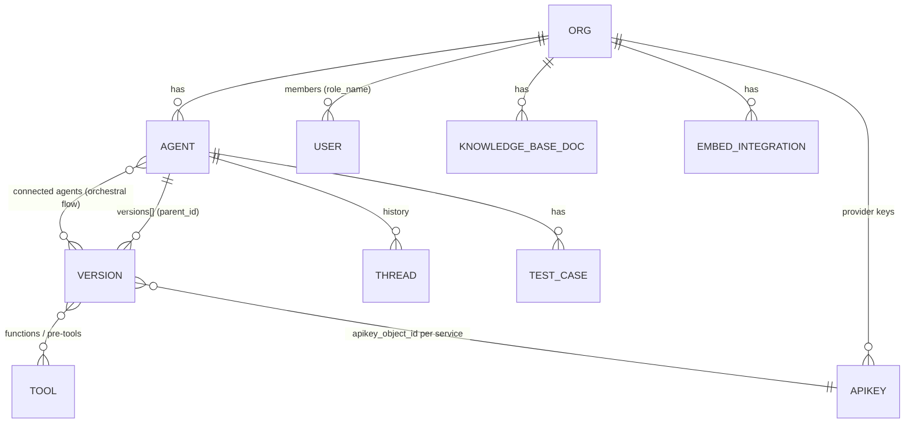

# Data Model & APIs

This repo has **no database or server code**. Entities are owned by the Node and Python backends. The frontend sees them as API responses cached in Redux. Field lists below are what the frontend reads; the backend is the authority (inferred from usage, not from a schema).

## Entities (as the frontend sees them)

| Entity               | Identified by                 | Redux location                                                                                                                      | Notes                                                                              |
| -------------------- | ----------------------------- | ----------------------------------------------------------------------------------------------------------------------------------- | ---------------------------------------------------------------------------------- |
| Org                  | `org_id` (route param)        | `orgReducer.organizations`, `orgReducer.currentOrgId`, `userDetailsReducer.organizations[org_id]` (includes `role_name`)            | Blocked orgs: `userDetailsReducer.blockedOrgIds` / `blockedOrgReasons`             |
| User                 | —                             | `userDetailsReducer.userDetails` (`meta.type === "embed"` marks embed users), `orgReducer.users`                                    |                                                                                    |
| Agent (bridge)       | `_id` / `bridge_id`           | `bridgeReducer.allBridgesMap[bridgeId]` (has `versions[]`, `published_version_id`); per-org list in `bridgeReducer.org[orgId].orgs` | Called "bridge" in code; API path `/api/agent/`                                    |
| Version              | `_id`, `parent_id` = agent id | `bridgeReducer.bridgeVersionMapping[agentId][versionId]`                                                                            | Holds prompt, model config, tools, variables. Read with `useConfigurationSelector` |
| Thread/history       | `thread_id`, sub-thread id    | `historyReducer.{history, thread, subThreads, versionHistory}`                                                                      |                                                                                    |
| Test chat            | channel id                    | `chatReducer.*ByChannel`                                                                                                            | Messages, files, images, test case per chat channel                                |
| API key              | `_id`, scoped by `org_id`     | `apiKeysReducer.apikeys[org_id][]`, `apikeysByBridgeVersion`                                                                        | Optimistic update with `backupApiKeysReducer` / `apikeyRollBackReducer`            |
| Service / model      | service name (e.g. `openai`)  | `serviceReducer.services`, `modelReducer.serviceModels`                                                                             | `utils/jevQuestions.js` covers the special `typesafe` service                      |
| Knowledge base       | doc/resource id               | `knowledgeBaseReducer.knowledgeBaseData`                                                                                            |                                                                                    |
| Embed integration    | folder id / embed token       | `integrationReducer.{integrationData, embedTokens, gtwyAccessToken}`                                                                |                                                                                    |
| Chatbot              | —                             | `ChatBot.ChatBotMap` (key is `ChatBot`, not `...Reducer`)                                                                           |                                                                                    |
| Test case            | —                             | `testCasesReducer.{testCases, testRuns}`, `testCaseConfigReducer.configs`                                                           |                                                                                    |
| Variables            | agent/version                 | `variableReducer.VariableMapping`                                                                                                   |                                                                                    |
| Connected-agent flow | org → agent → version         | `orchestralFlowReducer.connectedAgentFlowByBridge[orgId][bridgeId][versionId]`                                                      |                                                                                    |
| Folders              | —                             | `folderReducer.folders`                                                                                                             |                                                                                    |
| Billing              | —                             | `planReducer`, `walletReducer`                                                                                                      |                                                                                    |
| Embed session        | —                             | `appInfoReducer.embedUserDetails` (shape in [../AI_INSTRUCTIONS.md](../AI_INSTRUCTIONS.md#embed-redux-state-shape))                 |                                                                                    |

## Client state — `store/store.js`

28 slices are combined under these keys (the key is what selectors use: `state.<key>`):
`bridgeReducer, modelReducer, historyReducer, dryRunReducer, userDetailsReducer, authDataReducer, orgReducer, responseTypeReducer, ChatBot, knowledgeBaseReducer, testCasesReducer, serviceReducer, gtwyAgentReducer, flowDataReducer, integrationReducer, authReducer, orchestralFlowReducer, prebuiltPromptReducer, apiKeysReducer, variableReducer, chatReducer, appInfoReducer, richUiTemplateReducer, folderReducer, testCaseConfigReducer, analyticsReducer, planReducer, walletReducer`.

**Persisted to localStorage** (the `whitelist`): `authDataReducer, bridgeReducer, orgReducer, userDetailsReducer, serviceReducer, modelReducer, flowDataReducer, apiKeysReducer, variableReducer, orchestralFlowReducer, appInfoReducer, testCaseConfigReducer`. A new slice is not persisted unless you add it here.

## API endpoints by client file

Base: `URL` = `NEXT_PUBLIC_SERVER_URL` (Node), `PYTHON_URL` = `NEXT_PUBLIC_PYTHON_SERVER_URL`, `PROXY_URL` = `NEXT_PUBLIC_PROXY_URL`. Paths are prefixes; IDs are appended. Grep the file for the exact function. UI code reaches these only through the matching `store/action/*` file (see [UTILITIES.md § Redux actions](UTILITIES.md#redux-actions--storeaction)).

| File                                  | Main endpoints                                                                                                                                                                           |
| ------------------------------------- | ---------------------------------------------------------------------------------------------------------------------------------------------------------------------------------------- |
| `config/bridgeApi.js`                 | `URL/api/agent/` (CRUD), `URL/api/versions/` (+ `connected-agents/`, `suggest-model/`), `URL/api/template/`, `URL/api/tools/agents-versions-by-functions`, `PYTHON_URL/bridge/duplicate` |
| `config/authApi.js`                   | `URL/api/auth/`, `URL/api/user/{localToken,switchOrg,updateDetails,deleteUser}`, `URL/api/runagents/{login,public/login}`, `PROXY_URL/api/c/{getDetails,authkey,logout}`                 |
| `config/organizationApi.js`           | `URL/api/organization`, `URL/api/block_org`, `URL/api/utils/users-details`, `PROXY_URL/api/c/{getCompanies,getUsers,addUser,switchCompany}`                                              |
| `config/modelApi.js`                  | `URL/api/apikeys`, `URL/api/models`, `URL/api/service`, `URL/api/v1/model/completion`, `PYTHON_URL/api/v2/model/{chat/completion,batch/chat/completion,rerun}`                           |
| `config/historyApi.js`                | `URL/api/history/`, `URL/api/v1/config/{gethistory,history/sub-thread}/`, `URL/api/v1/agentConfig/systemprompt/gethistory/`                                                              |
| `config/knowledgeBaseApi.js`          | `URL/api/rag/{docs,resource}`, `PYTHON_URL/rag/query`                                                                                                                                    |
| `config/integrationApi.js`            | `URL/api/embed/`, `URL/api/utils/{token,affiliate/embed-token}`                                                                                                                          |
| `config/chatbotApi.js`                | `URL/api/chatbot/`, `URL/chatbot/`, `URL/api/chatbot/agent`                                                                                                                              |
| `config/testCaseApi.js`               | `URL/api/testcases/`, `URL/api/utils/call-gtwy`, `PYTHON_URL/api/v2/model/testcases`                                                                                                     |
| `config/metricsApi.js`                | `URL/api/metrics`, `URL/api/v1/agentConfig/userfeedbackcount/`, `URL/api/v1/config/getFineTuneData/`                                                                                     |
| `config/analyticsApi.js`              | `URL/api/analytics/{agent,embed}/`                                                                                                                                                       |
| `config/utilityApi.js` (34 fns)       | `URL/api/tools/` (+ `inbuilt`), `URL/api/alerting`, `URL/api/prebuilt_prompt`, `URL/api/runagents/`, `URL/api/rich_ui_templates`, `URL/showcase/all`, `PYTHON_URL/image/processing/`     |
| `config/richUiTemplateApi.js`         | `URL/api/rich_ui_templates/`                                                                                                                                                             |
| `config/folderApi.js`                 | `URL/api/folder`                                                                                                                                                                         |
| `config/billingApi.js` ⚠ not in index | `URL/api/billing/{subscription,checkout,portal,cancel,resume,retry,subscribe}`                                                                                                           |
| `config/walletApi.js` ⚠ not in index  | `URL/api/lago/{wallet,plan/org/me}`, `URL/api/billing/{credit-packs,invoices,credits}`, `URL/api/billing-plans/org/public`                                                               |

## Routes (pages)

`app/` pages: `/`, `/login`, `/auth_verify`, `/new`, `/billing`, `/chatbotPreview`, `/embed`, `/session-expired`, `/org`, `/org/onBoarding`, and under `/org/[org_id]/`: `agents`, `agents/configure/[id]`, `agents/history/[id]` (+ `/visualize`), `agents/analytics/[id]`, `agents/testcase/[id]`, `addNewModel`, `alerts`, `apikeys`, `auth_route`, `chatbotConfig`, `feedback`, `getting_started`, `integration` (+ `[folder_id]`), `RAG_embed` (+ `[folder_id]`), `invite`, `knowledge_base`, `lifetime-access`, `metrics`, `model-garden`, `orgDetails`, `pauthkey`, `plans`, `prebuilt-prompts`, `referAndEarn`, `tools`, `userDetails`, `widgets`, `workspaceSetting`. There are no `app/api/` route handlers.

## Environment variables

Names only. All are `NEXT_PUBLIC_*` and therefore **shipped to the browser**: never put secrets in them. ✱ = in `.env.example`.

| Variable                                                                  | Used in (main)                                               | Purpose                            |
| ------------------------------------------------------------------------- | ------------------------------------------------------------ | ---------------------------------- |
| `NEXT_PUBLIC_SERVER_URL` ✱                                                | `config/*`                                                   | Node backend base URL (required)   |
| `NEXT_PUBLIC_PYTHON_SERVER_URL` ✱                                         | `config/{bridge,model,knowledgeBase,testCase,utility}Api.js` | Python backend base URL (required) |
| `NEXT_PUBLIC_PYTHON_SERVER_WITH_PROXY_URL`                                | 12 references                                                | Python backend through the proxy   |
| `NEXT_PUBLIC_PROXY_URL` ✱                                                 | `config/authApi.js`, `utils/interceptor.js`                  | Proxy auth service (required)      |
| `NEXT_PUBLIC_FRONTEND_URL` ✱                                              | 12 references                                                | Own origin for links and embeds    |
| `NEXT_PUBLIC_ENV`                                                         | `app/error.js`, `components/NetworkStatus.js`, …             | Compared to `"PROD"` / `"LOCAL"`   |
| `NEXT_PUBLIC_REFERENCEID` ✱                                               | `config/organizationApi.js`                                  | Proxy reference id                 |
| `NEXT_PUBLIC_PROXY_USER_ROLE_ID`                                          | 3 references                                                 | Proxy role id                      |
| `NEXT_PUBLIC_CHATBOT_SCRIPT_SRC` ✱, `NEXT_PUBLIC_CHATBOT_SCRIPT_SRC_PROD` | embed loaders                                                | Chatbot script URL                 |
| `NEXT_PUBLIC_EMBED_SCRIPT_ID` ✱, `NEXT_PUBLIC_EMBED_SCRIPT_SRC` ✱         | embed loaders                                                | Embed script                       |
| `NEXT_PUBLIC_KNOWLEDGEBASE_SCRIPT_SRC`                                    | embed loader                                                 | KB script                          |
| `NEXT_PUBLIC_CHATBOT_PREVIEW_URL`                                         | chatbot preview                                              |                                    |
| `NEXT_PUBLIC_POSTHOG_KEY`, `NEXT_PUBLIC_POSTHOG_HOST`                     | `utils/posthog.js`                                           | Analytics                          |
| `NEXT_PUBLIC_ONE_HASH_CAL_EMBED_URL`                                      | Cal.com embed                                                |                                    |
| `NEXT_PUBLIC_FRILLURL`                                                    | `app/org/[org_id]/feedback/page.js`                          | Feedback widget iframe             |

`GTWY_PAUTHKEY` / `GTWY_AGENT_ID` appear only inside the code snippets that `utils/gtwySkill.js` shows to users. The app doesn't read them.
